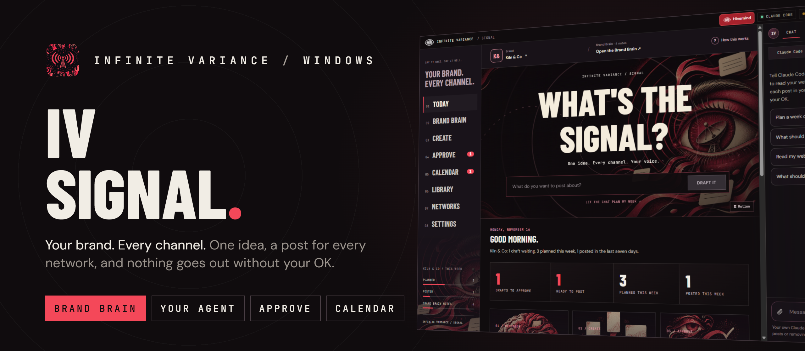
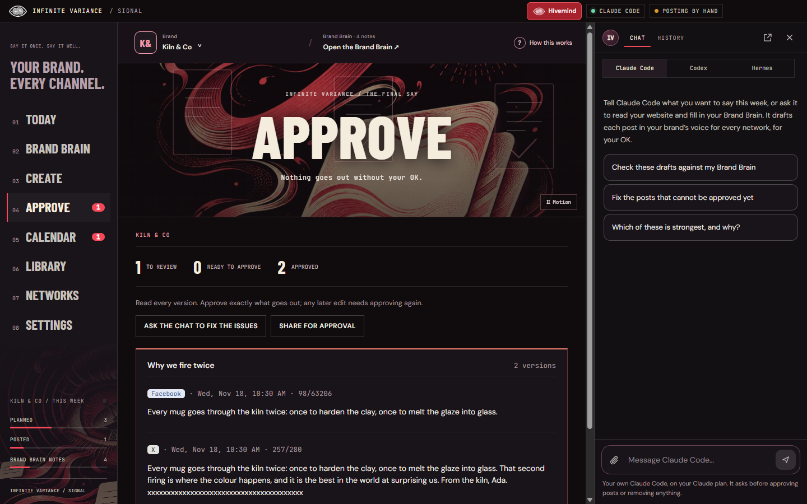
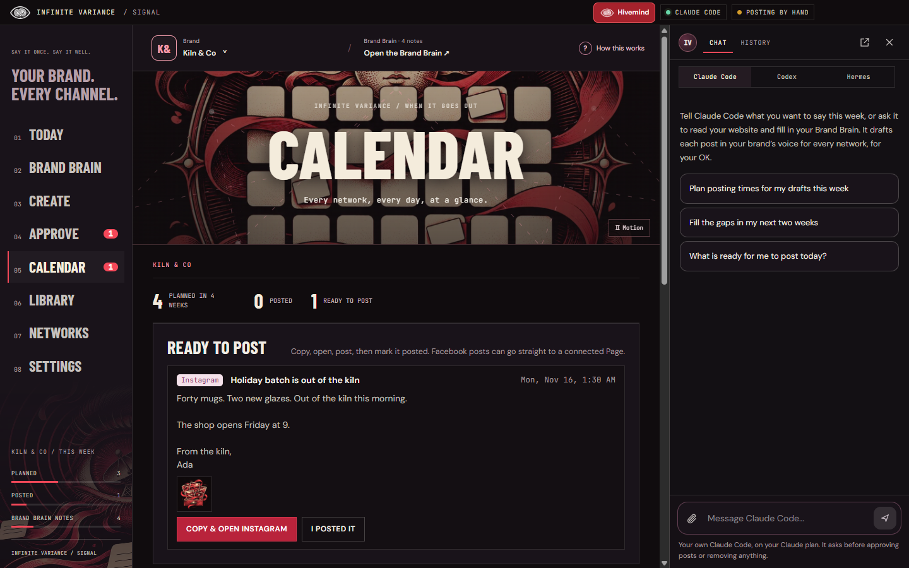

  

  <a href="https://github.com/hollisorg/iv-signal-releases/releases/latest"><b>Download for Windows</b></a>
  &nbsp;·&nbsp;
  <a href="https://github.com/hollisorg/iv-signal">Source and full guide</a>
  &nbsp;·&nbsp;
  <a href="https://infinitevariance.ai">Infinite Variance</a>

# IV Signal releases

Installers and update files for **IV Signal**, the free Infinite Variance marketing workstation. Keep each
brand's voice, offer and rules in a Brand Brain, write one idea as a post for every network, approve exactly
what goes out, and plan it on a calendar. The chat runs on your own Claude Code, Codex or Hermes, and
everything stays on your PC.

<table>
  <tr>
    <td width="50%"></td>
    <td width="50%"></td>
  </tr>
  <tr>
    <td align="center">Approve: nothing goes out without your OK</td>
    <td align="center">Calendar: every network, every day</td>
  </tr>
</table>

## Install

1. Download the newest `IV-Signal-Setup-<version>.exe` from
   [the latest release](https://github.com/hollisorg/iv-signal-releases/releases/latest) (Windows 10 or 11, 64-bit).
2. Run it. The installer isn't code-signed yet, so Windows may show **"Windows protected your PC"**: choose
   **More info → Run anyway**.

The app downloads its updates from here by itself, with no account or sign-in.

This repository holds releases only. The source code, with what every page does and how to build it, is in
[hollisorg/iv-signal](https://github.com/hollisorg/iv-signal). The screenshots show Kiln & Co, a fictional brand.
